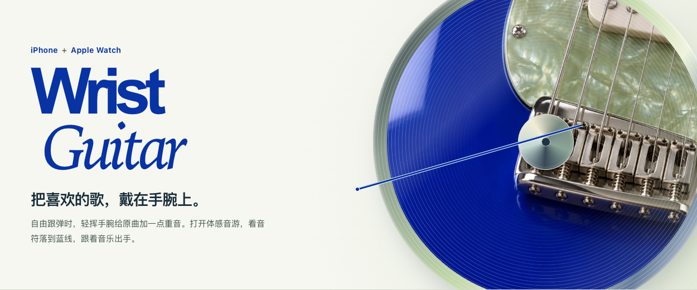

# Wrist Guitar



把喜欢的歌导入 iPhone，戴上 Apple Watch，就能用手腕加入演奏。想随音乐放松时，在手表上自由跟弹；想挑战节奏时，看着手机上的音符落线，挥腕打出连击。

**当前版本 v0.2.0 · iOS 18+ · watchOS 11+**　面向 Apple Watch Series 10 设计。

## 两种玩法

| | 自由跟弹 | 体感音游 |
| --- | --- | --- |
| 看哪里 | 手表上的唱片、琴弦与播放进度 | iPhone 上的下落音符、判定线和得分 |
| 怎么玩 | 歌曲在手表上连续播放。随时挥腕，给当前乐句添一道重音，停手听它自然收住 | 看音符接近蓝线时挥腕。每次有效动作都有击弦声和回弹，合拍累计得分和连击 |
| 在哪出声 | 手表播放本地歌曲与演奏声 | 开局前选 iPhone 或 Apple Watch，原曲和反馈从同一端播放 |
| 第一次怎么试 | 点「随手练习」。可以校准舒服的挥幅，按需开启演奏触感 | 从 iPhone 的「体感音游」进入，选「手表挥腕」。手表暂时不在身边时可选「点屏练习」 |

[观看 11.5 秒带声演示](docs/media/rhythm-preview.mp4) · [查看页面展览与使用截图](docs/SHOWCASE.md) · [查看当前版与两个历史版本](CHANGELOG.md)

## 导入自己的歌

1. 在 iPhone 资料库点「导入」，选择 MP3、M4A、WAV 或 AIFF。单个文件上限为 100 MiB。
2. 自由跟弹时，点「用手表弹」，等手表就绪后开始。音游选 iPhone 出声时，歌曲留在手机便可开局。选手表出声时，先将所选歌曲版本送到手表。
3. 双端音游需要两端都打开 Wrist Guitar。手机分析本地录音的节奏，手表为每次动作记录采集时间。整首打完后，手机按曲目版本和操作方式保存个人纪录。

## 获取与构建

未签名 IPA 内含 iPhone 应用和配套 Watch 应用。安装到设备时，两端都需要与你的设备匹配的签名。历史代码可按标签检出，例如 `git switch --detach v0.1.19`。

使用完整 Xcode 打开 `AirGuitar.xcodeproj` 并选择 `AirGuitarPhone`。此版本已用 Xcode 27.2 构建。独立核心测试可在项目根目录运行。

```sh
xcrun swift test --package-path Core
```

关于音频处理、动作校准、播放路由、真机验证范围及未签名打包命令，见[技术与构建说明](docs/TECHNICAL.md)。音游演示使用内置原创练习曲和模拟挥腕输入。Series 10 的外放听感与真实联机延迟留待设备实测。

[音频与图像来源](docs/CREDITS.md) · [可复用的项目介绍](docs/INTRO.md)

