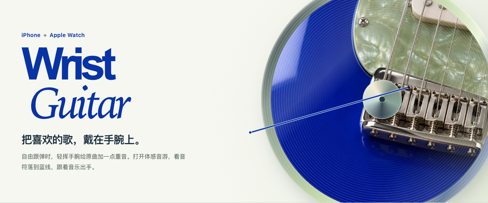
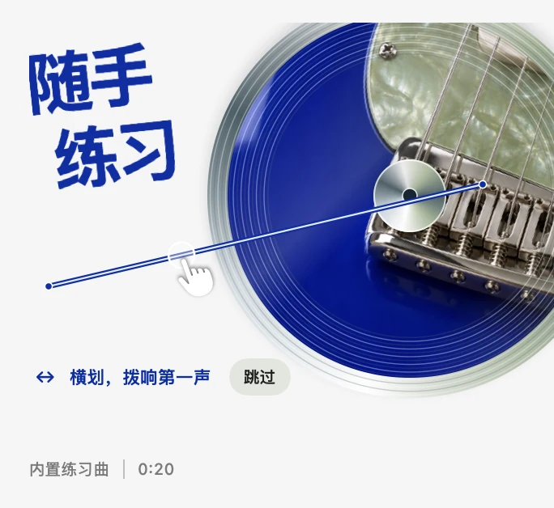
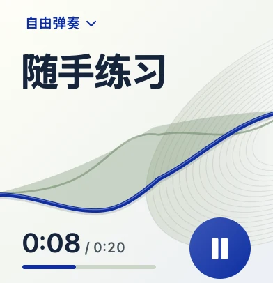
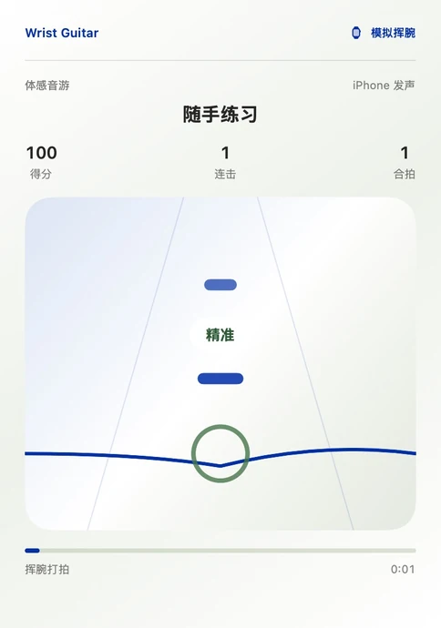

# Wrist Guitar 界面与演示

## 自由跟弹

在 iPhone 的资料库上横划唱片，松手可以听到第一声试拨。把歌送到手表后，手表独立播放，琴弦在有效挥腕后回弹。

## 体感音游

看手机上的音符落到判定线，用手腕击出节奏。整首歌连续播放，你可以自由留白。以下带声视频使用内置练习曲与模拟挥腕输入。

[播放或下载 MP4](media/rhythm-preview.mp4)

## 离线展示页

下载并解压项目交付包，打开 `Source/docs/index.html` 即可查看完整页面。通过 Git 检出源码时，直接打开 `docs/index.html`。页面、图片、视频和字幕均可从本地读取。
